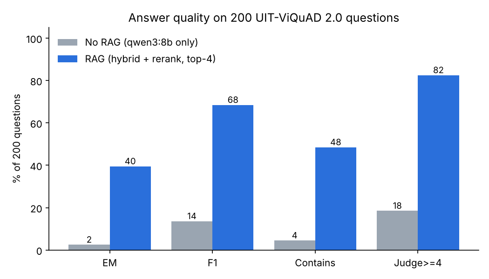
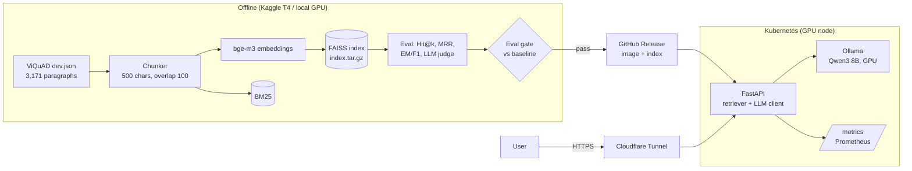

# RAG Chatbot for Vietnamese Wikipedia QA

An end-to-end Retrieval-Augmented Generation (RAG) system for Vietnamese question answering, built and operated as a small production service:

- **Model side**: LangChain + FAISS + `bge-m3` embeddings + BM25 hybrid search + an open-source LLM (**Qwen2.5 7B**) served by **Ollama**.
- **Evaluation side**: a reproducible benchmark on UIT-ViQuAD 2.0 (retrieval Hit@k/MRR on 3,852 questions; EM, F1 and an LLM judge on 50 questions). Each version changes one factor and runs on a free Kaggle T4 GPU.
- **Ops side**: FastAPI service, Docker, Helm chart for Kubernetes with a GPU node, CI with an **eval gate**, Prometheus metrics, and public HTTPS through Cloudflare Tunnel.

## Results

| Version | Change (one factor) | Hit@1 | Hit@4 | MRR@10 | EM | F1 | Judge ≥ 4 | Gate |
|---|---|---:|---:|---:|---:|---:|---:|:---:|
| no RAG | Qwen2.5 7B alone | - | - | - | 3.0% | 12.6% | 17.0% | - |
| v0_dense | bge-m3 + FAISS, top-4 | 75.9% | 90.4% | 0.828 | **39.0%** | **65.7%** | **75.5%** | baseline |
| v1_hybrid | + BM25, RRF fusion | 79.9% | 93.1% | 0.862 | 38.0% | 63.6% | 74.0% | PASS |
| v2_rerank | + bge-reranker-v2-m3 (top-20 → 4) | 90.2% | 97.1% | 0.934 | 39.0% | 64.7% | 76.5% | PASS |
| **v3_qwen3** | answer LLM → Qwen3 8B | **90.2%** | **97.1%** | **0.934** | **39.5%** | **68.5%** | **82.5%** | PASS |

Hit@k and MRR: all 3,852 answerable dev questions. EM, F1 and Judge ≥ 4: 200 test questions (Evaluation v2), judged by **Gemma 2 9B**, a different model family from the Qwen answer model. The second judge (Qwen2.5 7B) agrees with it on 91-93% of answers (**Cohen's kappa 0.82-0.85**, "almost perfect" agreement), so the judge scores are reliable (v2: kappa 0.84). Why each version was tried, and what happened, is written in [CHANGELOG.md](CHANGELOG.md).



Main findings so far:
- **RAG is worth +53 F1 points**: 12.6% → 65.7% on 200 questions. Without context, the 7B model mostly says "Không biết" or guesses.
- **Best system (v3, in production)**: hybrid search + reranker + Qwen3 8B. F1 **68.5%**, judge ≥ 4 **82.5%** on 200 questions, faithfulness 4.57/5, ~1 s per answer on a T4.
- **Retrieval is essentially solved by v2**: hybrid search + cross-encoder reranking lifts Hit@1 from 75.9% (v0) to **90.2%** and Hit@4 to **97.1%** on 3,852 questions (MRR@10 0.828 → 0.934). 
- **Better retrieval did not move answer quality much**: v0, v1 and v2 are statistically tied on F1 (v2 vs v1: ΔF1 +1.2, 95% CI −3.7 .. +5.9). Judge ≥ 4 is highest for v2 (76.5%).
- **The bottleneck then moved to the reader, and v3 confirms it**: with the same retrieval, swapping Qwen2.5 7B for Qwen3 8B raises F1 by +3.7 points (95% CI −0.7 .. +8.1) and judge ≥ 4 from 76.5% to 82.5%; both judges agree on the gain (Qwen judge: 72.5% → 80.5%). Qwen3 also stops answering "Không biết" when the answer is in the context (8 → 0 of 200).

## Architecture



Request path: question → hybrid retrieval (BM25 + FAISS, RRF, top-20) → bge-reranker-v2-m3 → top-4 chunks → prompt → Qwen3 8B on Ollama (thinking off) → short answer + sources.

## Quickstart

### 1. Ask the API locally (docker compose, NVIDIA GPU)

```bash
make data            # download UIT-ViQuAD 2.0 (Kaggle API token needed)
make index           # build artifacts/index (or download index.tar.gz from a Release)
make up              # Ollama (GPU) + API on :8000
curl -s localhost:8000/ask -H 'content-type: application/json' \
  -d '{"question": "Bức tường Berlin được xây dựng vào năm nào?"}' | jq
```

Response shape:

```json
{
  "answer": "...",
  "sources": [{"title": "Bức tường Berlin", "ctx_id": 0, "text": "Bức tường Berlin: ..."}],
  "latency_ms": {"retrieve": 0.0, "generate": 0.0},
  "version": "0.3.0"
}
```

Interactive docs: `http://localhost:8000/docs`. Metrics: `/metrics`. Health: `/healthz`, `/readyz`.

### 2. Deploy to Kubernetes

Prerequisites: a cluster with an NVIDIA GPU node (NVIDIA device plugin, e.g. through the GPU Operator) and a default StorageClass. A single-node k3s on a GPU workstation works.

```bash
# 1) the image is built by CI on a tag; the index is a Release asset
git tag v0.3.0 && git push --tags
gh release upload v0.3.0 artifacts/index.tar.gz

# 2) install
helm upgrade --install rag deploy/helm/rag-chatbot -n rag --create-namespace \
  --set image.tag=0.3.0 \
  --set index.url=https://github.com/MinhTime/rag-chatbot/releases/download/v0.3.0/index.tar.gz

# 3) public HTTPS without opening router ports: Cloudflare Tunnel
kubectl -n rag create secret generic cloudflared --from-literal=token=<TUNNEL_TOKEN>
helm upgrade rag deploy/helm/rag-chatbot -n rag --reuse-values --set cloudflared.enabled=true
```

In the Cloudflare dashboard, route your hostname to `http://rag-rag-chatbot:8000`. If you already have an ingress controller and a public IP, use `--set ingress.enabled=true,ingress.host=...` instead.

What the chart runs:

| Component | Kind | Notes |
|---|---|---|
| Ollama | Deployment + PVC | 1 GPU, pulls the model once onto the PVC, `Recreate` strategy |
| API | Deployment + Service | CPU, non-root, startup/readiness/liveness probes, Prometheus annotations |
| fetch-index | initContainer | downloads the versioned FAISS index (the "model artifact") |
| HF cache | PVC | keeps bge-m3 between restarts |
| Ingress / cloudflared / HPA | optional | `ingress.enabled`, `cloudflared.enabled`, `autoscaling.enabled` |

## From evaluation to production (the lifecycle)

```
1. Experiment   add a version in scripts/build_notebook.py (ONE change + why)
2. Evaluate     GitHub Actions "eval" -> runs the notebook on Kaggle T4 -> results/<version>/
3. Gate         scripts/kaggle_eval.py gate: fail if Hit@4, MRR, F1 or judge drop vs baseline
4. Release      tag vX.Y.Z -> CI builds ghcr.io/minhtime/rag-chatbot:X.Y.Z, index.tar.gz -> Release
5. Deploy       helm upgrade --set image.tag=X.Y.Z (rollback: helm rollback rag)
6. Monitor      /metrics: request count, latency per stage, "Không biết" rate -> Prometheus/Grafana
```

Versioning rules:
- **Experiment versions** (`v1_hybrid`, `v2_rerank`, ...) are research steps. Each one has its own notebook, its own results folder and a CHANGELOG entry.
- **Release versions** (`v0.3.0`, ...) are what runs in production. The image tag, the Helm `appVersion`, the index asset and the git tag all share the same number, so you always know which model and code is serving.

## Reproduce the experiments on Kaggle

Open `notebooks/<version>_kaggle.ipynb` on Kaggle, set Accelerator to GPU T4, turn Internet on, add the dataset `gamind/uit-viquad-2-0`, then Run All. Or from the CLI:

```bash
export KAGGLE_USERNAME=... KAGGLE_KEY=...
python scripts/kaggle_eval.py run v1_hybrid --baseline v0_dense   # push, wait, collect, gate
```

The notebook writes `src/` itself (generated by `scripts/build_notebook.py`), so Kaggle runs exactly the code in this repo.

## Evaluation details

| Item | Setting |
|---|---|
| Dataset | [UIT-ViQuAD 2.0](https://www.kaggle.com/datasets/gamind/uit-viquad-2-0), dev split |
| Corpus | 3,171 unique paragraphs, 138 Wikipedia articles, 7,802 chunks |
| Test set | 200 answerable questions: the original 50 (seed 42) + 150 (seed 43) ([data/questions_200.json](data/questions_200.json)) |
| Retrieval metrics | Hit@k and MRR: a chunk from the gold paragraph is in the top-k |
| Answer metrics | EM and F1 (SQuAD-style, Vietnamese NFC, syllable tokens), Contains, LLM judge 1-5 and faithfulness 1-5 by **Gemma 2 9B** (independent family), second judge Qwen2.5 7B + Cohen's kappa |
| Gate | Hit@4, MRR@10, F1, Judge ≥ 4 vs the best version; F1 drop must also be significant (paired bootstrap 95% CI) |
| LLM settings | temperature 0, `num_ctx` 4096, short-answer Vietnamese prompt |

## Repository layout

```
├── src/
│   ├── config.py         # all settings (one dataclass)
│   ├── data.py           # load ViQuAD, corpus, chunking, test sample
│   ├── retrieval.py      # dense / hybrid (BM25 + FAISS, RRF) / cross-encoder rerank
│   ├── rag.py            # embeddings, prompts, LLM (Ollama), RAGChatbot
│   ├── metrics.py        # EM, F1, Contains, Hit@k, MRR
│   ├── judge.py          # LLM-as-judge
│   ├── evaluate.py       # offline evaluation pipeline
│   ├── index_store.py    # build / save / load the FAISS index
│   ├── api.py            # FastAPI service
│   ├── ollama_utils.py, plots.py
├── notebooks/            # one Kaggle notebook per experiment version
├── results/<version>/    # metrics.json, predictions.csv, curves, plots, Kaggle log
├── scripts/              # build_notebook.py, kaggle_eval.py (push/collect/gate), setup_ollama.sh
├── tests/                # unit tests: metrics, retrieval, API (no GPU needed)
├── docker/Dockerfile, docker-compose.yml
├── deploy/helm/rag-chatbot/
├── .github/workflows/    # ci.yml (lint, test, helm, image), eval.yml (Kaggle + gate)
├── Makefile, pyproject.toml, requirements*.txt, CHANGELOG.md
```

## Development

```bash
make install   # dev deps (CPU is fine)
make lint test # ruff + pytest
make notebooks # regenerate notebooks after editing src/
make help      # all targets
```

## Limitations

- LLM judges are still models: Gemma 2 9B is independent of the Qwen answer model, but it is small. The kappa with the second judge shows how much to trust it. EM and F1 do not depend on any judge.
- 200 questions is still modest (one question = 0.5 point), so the gate uses a bootstrap CI. Retrieval metrics use all 3,852 questions and are more stable.
- The corpus is closed (dev-set paragraphs only), and some ViQuAD questions assume you already know the paragraph ("the island"). This makes open retrieval harder than in real use.
- The API runs embeddings and the reranker on CPU so that the single GPU stays with Ollama. The reranker scores 20 passages per question: ~0.15 s on a T4, roughly 1-3 s on CPU. Set `rag.reranker: ""` to fall back to v1 (hybrid only) if latency matters more, or give the API a GPU share (NVIDIA time-slicing) and `rag.device: cuda`.
