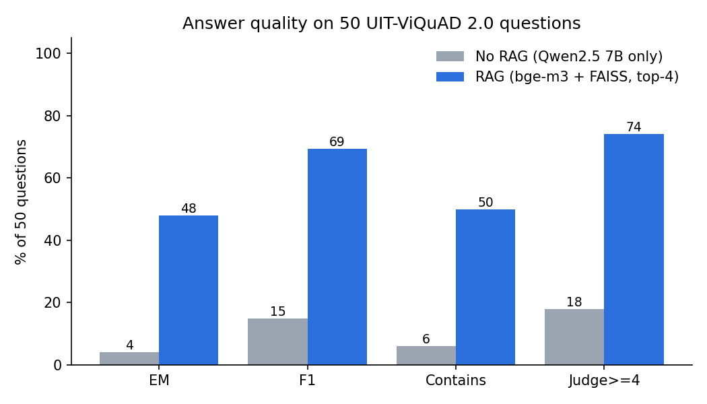
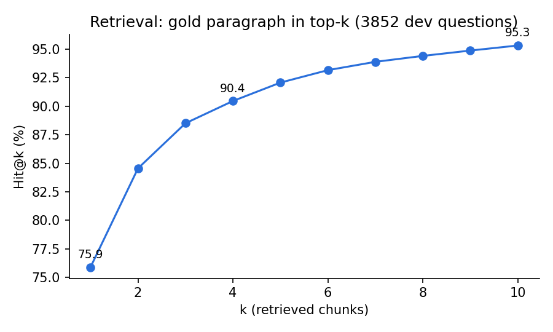

# RAG Chatbot for Vietnamese Wikipedia QA

A small Retrieval-Augmented Generation (RAG) chatbot that answers Vietnamese questions about Wikipedia articles, built with **LangChain**, **FAISS**, **bge-m3** embeddings and the open-source LLM **Qwen2.5 7B** served locally by **Ollama**. Everything runs in one Kaggle notebook on a free T4 GPU (about 12 minutes).

We evaluate it on **50 questions** from UIT-ViQuAD 2.0 and compare it with the same LLM **without retrieval**, so the only difference between the two systems is the retrieved context.

## Results

| 50 test questions | No RAG | **RAG** |
|---|---:|---:|
| Exact Match | 4% | **48%** |
| F1 (syllable) | 14.9% | **69.3%** |
| Contains gold answer | 6% | **50%** |
| LLM judge, mean score (1-5) | 2.00 | **3.90** |
| LLM judge, score ≥ 4 | 18% | **74%** |
| Faithfulness to context (1-5) | - | 4.64 |
| Time per answer (T4) | 0.25 s | 0.78 s |



**Retrieval** (gold paragraph found in the top-k chunks), measured on **all 3,852 answerable dev questions**:

| Hit@1 | Hit@4 | Hit@10 | MRR@4 |
|---:|---:|---:|---:|
| 75.9% | 90.4% | 95.3% | 0.820 |



**Takeaways**
- RAG raises F1 from 15% to 69%. Without context, the 7B model rarely knows these specific facts: it answers "Không biết" (I don't know) 17 times out of 50 and often guesses wrong.
- Retrieval is the bottleneck when it fails: on the 46 questions where the gold paragraph was retrieved, RAG reaches F1 74.7% (judge 4.07); on the 4 misses, F1 drops to 7.4% (judge 2.0).
- EM is strict for generative answers (e.g. "Hạ viện" vs gold "Quốc hội", or long gold spans), so F1 and the judge score give a fairer picture.

## How it works

```
dev.json (3,171 paragraphs)
   │  RecursiveCharacterTextSplitter (500 chars, overlap 100, title prepended)
   ▼
7,802 chunks ──► bge-m3 embeddings ──► FAISS index
                                          │ top-4 chunks
question ─────────────────────────────────┤
                                          ▼
                 LangChain prompt ──► Qwen2.5 7B (Ollama, Q4_K_M, temperature 0) ──► answer
```

| Component | Choice |
|---|---|
| Dataset | [UIT-ViQuAD 2.0](https://www.kaggle.com/datasets/gamind/uit-viquad-2-0), dev split |
| Corpus | 3,171 unique paragraphs from 138 Wikipedia articles |
| Test set | 50 random answerable questions, seed 42 ([data/questions_50.json](data/questions_50.json)) |
| Chunking | 500 characters, 100 overlap, article title prepended to each chunk |
| Embeddings | `BAAI/bge-m3` (multilingual, normalized) |
| Vector store | FAISS (flat index), top-k = 4 |
| LLM | `qwen2.5:7b` via Ollama, temperature 0, short-answer prompt in Vietnamese |
| Judge | same `qwen2.5:7b`, JSON output |

## Metrics

- **EM / F1**: SQuAD-style, adapted to Vietnamese (lowercase, Unicode NFC, punctuation removed; F1 over syllables).
- **Contains**: 1 if a gold answer appears inside the model answer.
- **LLM judge, correctness (1-5)**: the model compares its answer with the gold answer.
- **Faithfulness (1-5)**: is the RAG answer supported by the retrieved chunks?
- **Hit@k / MRR**: does a retrieved chunk come from the paragraph that contains the gold answer?

## Repository layout

```
rag-chatbot/
├── README.md
├── requirements.txt
├── data/questions_50.json          # the 50 test questions with gold answers
├── notebooks/
│   └── rag_viquad_qwen_kaggle.ipynb  # end-to-end Kaggle notebook
├── src/
│   ├── config.py        # all settings
│   ├── data.py          # load ViQuAD, build corpus, chunk, sample questions
│   ├── rag.py           # embeddings, FAISS, prompts, RAGChatbot
│   ├── metrics.py       # EM, F1, Contains, Hit@k, MRR
│   ├── judge.py         # LLM-as-judge prompts
│   ├── evaluate.py      # full pipeline (also runnable as a script)
│   ├── ollama_utils.py  # start Ollama server, pull model
│   └── plots.py
├── scripts/
│   ├── build_notebook.py  # regenerates the notebook from src/
│   └── setup_ollama.sh    # install Ollama + pull model (local Linux)
└── results/
    ├── metrics.json             # all numbers above
    ├── predictions.csv          # per question: answers, scores, sources
    ├── retrieval_curve.csv      # Hit@1..10
    ├── rag_vs_norag.png, retrieval_hit_at_k.png
    ├── environment.json         # package versions, GPU
    └── kaggle_run.log           # full log of the Kaggle run
```

## Run it

**On Kaggle (recommended).** Create a notebook from `notebooks/rag_viquad_qwen_kaggle.ipynb`, set Accelerator = GPU T4, turn Internet on, add the dataset `gamind/uit-viquad-2-0`, then Run All. The notebook writes `src/` itself, installs Ollama and pulls the model.

Or push it with the Kaggle CLI:

```bash
kaggle kernels push -p <folder with the notebook and kernel-metadata.json> --accelerator NvidiaTeslaT4
```

**Locally (Linux + NVIDIA GPU).**

```bash
pip install -r requirements.txt
bash scripts/setup_ollama.sh qwen2.5:7b
kaggle datasets download gamind/uit-viquad-2-0 -p data --unzip
python -m src.evaluate --viquad_dev data/dev.json --out_dir results
```

Settings (chunk size, top-k, model names, ...) live in `src/config.py` and can be overridden on the command line, e.g. `--top_k 6 --llm_model llama3.1:8b`. After editing `src/`, run `python scripts/build_notebook.py` to refresh the notebook.

## Limitations

- **Self-judging**: the judge is the same 7B model that wrote the answers, so the judge score can be lenient (one no-RAG answer in mixed Chinese got 4/5). EM, F1 and Contains do not depend on the judge.
- **50 questions is small**: each question is worth 2 points of accuracy. Retrieval numbers use all 3,852 questions and are more stable.
- **Closed corpus**: the index only contains the dev-set paragraphs. Many ViQuAD questions are written with the paragraph in mind (e.g. "the island"), which makes open retrieval harder than in real use.

## Environment of the reported run

Kaggle, 2× Tesla T4 (one used), Python 3.13, Ollama 0.40.15, LangChain core 1.7.0, langchain-ollama 1.1.0, langchain-huggingface 1.2.3, sentence-transformers 5.7.0, faiss-cpu 1.15.1. Full list in `results/environment.json`.
